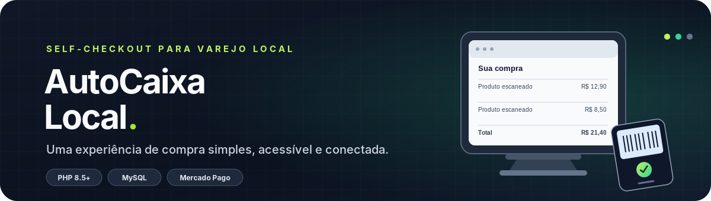

<p align="center">
  
</p>

<p align="center">
  
</p>

<p align="center">
  
  
  
</p>

<p align="center">
  <strong>Um caixa de autoatendimento acessível para lojas locais.</strong><br />

  Leia produtos, confira o carrinho e pague em uma experiência simples, com operação dedicada em modo quiosque.
</p>
Sobre o projeto
O AutoCaixa Local é uma proposta de sistema web de self-checkout voltada a pequenos comércios que desejam oferecer uma experiência de autoatendimento sem precisar investir inicialmente em uma solução industrial complexa.

A aplicação será hospedada em um servidor Linux com PHP e MySQL. Na loja, o cliente utilizará um computador com Windows, Microsoft Edge em tela cheia e Acesso Atribuído (Assigned Access) para manter o terminal restrito à experiência de compra.

O foco do MVP é começar por uma loja e um terminal, validando a operação de ponta a ponta antes de expandir para múltiplos estabelecimentos.
[!IMPORTANT]
Estado atual: projeto em planejamento/desenvolvimento inicial. As funcionalidades listadas neste README representam o escopo previsto; não significam que já estejam implementadas ou certificadas para uso comercial. Pagamentos reais, hardware e requisitos fiscais deverão ser validados antes da implantação.

Objetivos
- Oferecer uma alternativa acessível de autoatendimento para pequenos comerciantes.
- Permitir a leitura de produtos por código de barras.
- Exibir carrinho, quantidades, preços e total da compra.
- Integrar pagamentos presenciais por uma API oficial.
- Manter produtos, estoque e vendas em um banco MySQL.
- Disponibilizar um painel administrativo protegido.
- Operar no Edge em modo quiosque, reduzindo o acesso do cliente a outras funções do Windows.
- Criar uma base que possa evoluir para outras lojas e terminais.

Como a solução será organizada:
```mermaid
flowchart TD

    A [Cliente no terminal] --> B[Edge em modo quiosque].

    B -->|HTTPS| == C[Aplicação web hospedada].

    C --> D[Backend PHP].

    D <--> E[(MySQL)].

    D --> F[API de pagamentos].

    F <--> G[Terminal Point compatível].

    F -->|Notificações / consulta de estado| D

    D --> H[Venda confirmada e registro de estoque]
```
O navegador será responsável pela interface. O backend PHP será a autoridade para preços, regras da venda e validação do pagamento. O banco MySQL armazenará os dados do negócio; credenciais financeiras não deverão ser expostas no frontend.
Fluxo previsto de compra
<p align="center">
  <strong>Iniciar compra</strong> → <strong>Escanear produtos</strong> → <strong>Conferir carrinho</strong> → <strong>Escolher pagamento</strong> → <strong>Confirmar transação</strong> → <strong>Finalizar venda</strong>
</p>

1. O cliente toca em Iniciar compra.
2. Escaneia os produtos com um leitor USB de código de barras.
3. O sistema consulta o produto e o preço cadastrados.
4. O cliente confere os itens e o total calculado pelo servidor.
5. O backend cria a cobrança pela integração habilitada.
6. O pagamento é confirmado por consulta ou notificação validada do provedor.
7. O AutoCaixa Local utiliza PHP, HTML, CSS, JavaScript e MySQL para oferecer autoatendimento em lojas locais, com cadastro de produtos, controle de estoque e processamento seguro de vendas.

Tecnologias e infraestrutura:
- Backend: PHP 8.5.12 ou patch de segurança posterior.
- Interface: HTML5, templates PHP, CSS3 e JavaScript.
- Banco de dados: MySQL com InnoDB e acesso seguro via PDO.
- Hospedagem: servidor Linux com HTTPS.
- Totem: computador Windows com Microsoft Edge em modo quiosque, configurado pelo Assigned Access.
- Pagamentos: Mercado Pago Point com Orders API, condicionado à compatibilidade do terminal e da conta.
Segurança das vendas: o estoque será atualizado apenas uma vez por venda confirmada. Em caso de falha de conexão ou dúvida sobre o pagamento, o sistema verificará o estado real da transação antes de finalizar a compra.


Versão do PHP: consultar php.net/downloads antes da implantação e utilizar a versão estável suportada com os patches mais recentes. A referência inicial deste projeto é PHP 8.5.12, publicada em 21/10/2026.

Pagamentos
A integração financeira inicial planejada é o Mercado Pago Point, utilizando a API oficial vigente para pagamentos presenciais — incluindo o fluxo baseado em Orders API quando aplicável ao terminal escolhido.
- Documentação oficial do Mercado Pago Point
- Referência da API Point
O terminal candidato para o piloto é o Point Smart 2, sujeito à confirmação de compatibilidade da conta, do dispositivo e dos recursos de pagamento habilitados. Antes de comprar, conferir a lista vigente de dispositivos compatíveis na documentação oficial.
Regras obrigatórias de pagamento
- Não capturar números de cartão ou códigos de segurança em formulários próprios.
- Manter tokens e credenciais somente no backend.
- Validar notificações e consultar o estado real da transação.
- Implementar idempotência para evitar cobranças, vendas ou baixas de estoque duplicadas.
- Diferenciar pagamentos pendentes, aprovados, recusados, cancelados e estornados.
- Usar ambiente de teste antes de habilitar cobranças reais.
- Não considerar uma tela de sucesso ou captura de comprovante como prova de pagamento.
Segurança e confiabilidade
O projeto deverá incluir, desde o início:
- Consultas SQL preparadas via PDO.
- Hash seguro de senhas e autenticação administrativa.
- Controle de acesso verificado no backend.
- Proteção contra CSRF e XSS.
- Validação de dados e escape de saída HTML.
- Sessões PHP configuradas com atributos de segurança adequados.
- Segredos fora do diretório público e do repositório Git.
- HTTPS para a aplicação e as integrações externas.
- Logs de auditoria sem credenciais ou dados sensíveis.
- Transações MySQL em operações críticas.
- Backups e procedimento testado de restauração.
- Tratamento seguro para indisponibilidade do servidor ou do provedor financeiro.
O modo quiosque restringe a experiência do computador, mas não substitui a segurança do backend. A aplicação deverá continuar protegida mesmo quando acessada por outro dispositivo.
Equipamento e execução na loja
O computador do cliente abrirá a URL publicada no Microsoft Edge com o Acesso Atribuído configurado para o modo quiosque.

Componentes previstos:
- Computador Windows dedicado.
- Tela sensível ao toque, recomendada para a experiência final.
- Leitor USB de código de barras.
- Terminal de pagamento compatível com a API Point.
- Conexão estável com a internet.
- Impressora ou comprovante do terminal, conforme a operação escolhida.
A aplicação ficará hospedada na internet; o totem não deverá guardar no navegador credenciais privadas de pagamento nem depender de um servidor de desenvolvimento local.

Documentação oficial do Windows: Configurar quiosque de aplicativo único com Acesso Atribuído.
Estrutura planejada do repositório

    autocaixa-local/
    ├── public/
    │   ├── index.php
    │   └── assets/
    │       ├── css/
    │       ├── js/
    │       └── images/
    ├── app/
    │   ├── Controllers/
    │   ├── Services/
    │   ├── Repositories/
    │   ├── Models/
    │   ├── Views/
    │   ├── Middleware/
    │   └── Integrations/
    │       ├── Payments/
    │       └── Fiscal/
    ├── config/
    ├── database/
    │   ├── migrations/
    │   └── seeds/
    ├── tests/
    ├── scripts/
    ├── docs/
    ├── .env.example
    └── README.md
A estrutura será ajustada durante a implementação, mantendo a separação entre interface, regras de negócio, persistência e integrações. O diretório público do servidor deverá apontar para public/.
Roadmap
- [ ok ] Fase 0 — Planejamento: validar a loja piloto, o orçamento, a hospedagem, o leitor e o terminal.
- [ ok ] Fase 1 — MVP local: interface inicial, scanner, catálogo, carrinho e pagamento simulado.
- [ ok ] Fase 2 — Administração: produtos, estoque, vendas, autenticação e relatórios básicos.
- [ ok ] Fase 3 — Publicação: hospedagem Linux, domínio, HTTPS, MySQL e backups.
- [ ok ] Fase 4 — Pagamentos: integração em ambiente de teste com o Mercado Pago Point.
- [ ok ] Fase 5 — Equipamento: validar leitor físico, tela touchscreen e Edge com Acesso Atribuído.
- [ ok ] Fase 6 — Piloto: validar pagamentos reais, procedimentos fiscais e operação supervisionada.
- [ ok ] Fase 7 — Expansão: avaliar múltiplas lojas, múltiplos terminais e painel remoto.

<p align="center">
  <strong>AutoCaixa Local</strong><br />
  <sub>Self-checkout acessível, seguro e pensado para o comércio local.</sub>
</p>